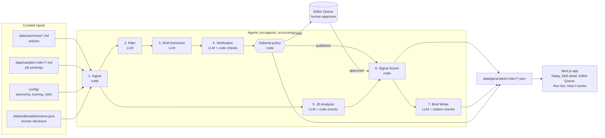

# Architecture

SkillShift is one TypeScript codebase. The same modules run in three places: the offline pipeline (`npm run pipeline`), the Live mode API route, and, for the pure-code parts, the browser.

## The pipeline at a glance

Two rules shape the design:

1. **LLMs read; code decides.** Every LLM output is validated by a Zod schema (`src/lib/llm.ts`, one retry on failure), and every decision that matters is plain code with values from `config/scoring.json`: keep or drop an article, publish or hold a shift, the quadrant a skill lands in. That is what makes the system explainable and unit-testable.
2. **No claim without evidence.** A shift must quote an excerpt that appears word for word in its article (checked by code, not by the model). JD mentions are checked the same way. Every sentence of the brief must cite a source id that was actually provided to the writer.

## From a raw article to a matrix cell

A worked example with the SAMPLE data: how **LLM evaluation** became **Rising**.

**1. Ingest (code, `src/agents/ingest.ts`).** `data/raw/news/<file>.md` is parsed (YAML front matter plus body) and validated against `ArticleFrontMatter` in `src/pipeline/schemas.ts`. A bad file stops the run with one error listing every problem.

**2. Filter (LLM, `src/agents/filter.ts`).** The model scores relevance to the role from 0 to 1 and names a duplicate if an earlier article reports the same event. Code then decides: keep if relevance is at least `editorial.filterMinRelevance` (0.5) and it is not a duplicate. Articles are processed oldest first, so the earliest report of an event wins.

**3. Shift Extraction (LLM, `src/agents/shift-extraction.ts`).** From a kept article, the model extracts "shifts" (a technology, practice, regulation, or market change), maps each to skills from `config/taxonomy.json`, quotes an excerpt of at most 14 words, and gives a confidence. It may propose a new skill, which always goes to a human.
Example: from "Platform vendor makes evaluation reports mandatory for agent launches" it extracts *"agents cannot launch without a signed evaluation report"* mapped to `llm-evaluation`, confidence 0.95.

**4. Verification (LLM plus code, `src/agents/verification.ts`).** Code first checks that the excerpt is really in the article. The model then judges whether the article supports the claim, assigns an evidence level (Strong, Moderate, Weak), and flags conflicts with shifts from other articles on the same skills.

**5. Editorial policy (code, `src/pipeline/editorial.ts`).** A shift is published only if the excerpt was found, the verifier says it is supported, confidence is at least 0.7, evidence is not Weak, there is no conflict, and it maps to a known skill. Otherwise it goes to the Editor Queue with every reason spelled out. Decisions already exported from the Editor Queue (`data/editorial/decisions.json`) are applied here: a held shift is published once every item that held it is approved. Decisions are matched by article and excerpt, so a re-run that renumbers shifts keeps them.

**6. JD Analyzer (LLM plus code, `src/agents/jd-analyzer.ts`).** For each job posting, the model lists required and preferred skills with excerpts. Code drops any excerpt that is not word for word in the posting and keeps one mention per skill per posting.

**7. Signal Scorer (code, `src/scoring/signal-scorer.ts`).** For each skill, using published shifts only:

| Signal | Formula | LLM evaluation (SAMPLE) |
|---|---|---|
| News signal | sum over articles of recency x source weight x evidence weight, divided by 3, capped at 1. Each article counts once per skill (its strongest shift). Recency halves every 45 days. | Three articles: 0.985 + 0.527 + 0.579 = 2.09; 2.09 / 3 = **0.70** |
| JD signal | (required x 1.0 + preferred x 0.5) / analyzed postings | (4 + 5 x 0.5) / 15 = **0.43** |
| Momentum | articles per day in the last 30 days vs the 180 days before, scaled to -1..1 | 3 recent, 0 earlier: **+1.0** |

Quadrant: news at least 0.40 **and** JD at least 0.35 is **Rising**. News only is Emerging, JD only is Established, neither with momentum at most -0.25 is Fading, anything else is Quiet. The thresholds are fixed values in `config/scoring.json`, and the matrix draws them as the dashed lines.

**8. Brief Writer (LLM, `src/agents/brief-writer.ts`).** Code picks the skills (Rising, then Emerging, then Fading; strongest news first) and builds an evidence pack of published shifts and JD excerpts. The model writes three items (What changed, Why it matters, What to do this week). Code checks that every factual field cites at least one source id from the pack and contains no em dash; a failure goes back to the model through the one retry.

**9. Output (`src/pipeline/output.ts`).** Everything is written to `data/generated/<role>/` and committed, so the app (and the demo) never waits on an API.

## The app

- **Pages are prerendered at build time** from `data/generated/<role>/*.json` (`src/lib/data.ts` validates each file with the same schemas). Role is part of the URL (`/tpm`, `/pm`); a role without data shows its Team expansion panel.
- **Screen logic is in pure functions** (`src/lib/view.ts`, `src/lib/matrix-layout.ts`, `src/lib/rescore.ts`, `src/lib/brief-script.ts`), unit tested in `tests/`.
- **Editor Queue:** decisions are stored in the browser (localStorage). The browser re-runs `applyDecisions` and the Signal Scorer, the exact code the pipeline uses, so approving an item moves its dot on Today immediately. "Export decisions" downloads `decisions.json` for the next pipeline run.
- **Live mode:** `POST /api/live` runs Filter, Shift Extraction, and Verification on one pasted article (`src/pipeline/live.ts`) and streams each step as a line of JSON. Before and after are scored as of the same date, so only the new article explains the difference. Nothing is saved. A passphrase (`LIVE_MODE_PASSPHRASE`) protects the API key, and any failure falls back to a recorded run (`live-cache.json`), clearly labeled.
- **Audio brief:** the browser's Web Speech API reads the brief aloud; no paid TTS and no server call.

## Quality and cost

- `npm run eval` grades Shift Extraction and JD Analyzer against hand labels in `data/eval/<role>.json`: precision and recall per (item, skill) pair, plus how often required vs preferred was right (`src/eval/evaluate.ts`). Results appear on How it works.
- `src/lib/llm.ts` logs tokens (including prompt-cache reads), latency, and retries for every call to `run-log.json`; How it works shows totals per agent.
- The system prompt of each agent (instructions plus taxonomy) is marked cacheable, so repeated calls within a run read it from the prompt cache.

## Extending to a team

Roles are data, not code. To add the PM vertical: set its `status` to `"full"` in `config/roles.json`, add JDs under `data/raw/jds/pm/`, tag skills with `"pm"` in `config/taxonomy.json`, label an eval set in `data/eval/pm.json`, and run `npm run pipeline -- --role pm`. Each team member can own one role vertical end to end.

Two boundaries are deliberate: the taxonomy stays a flat list (no graph of relations between skills), and verification stays a single model (no ensemble scoring).
